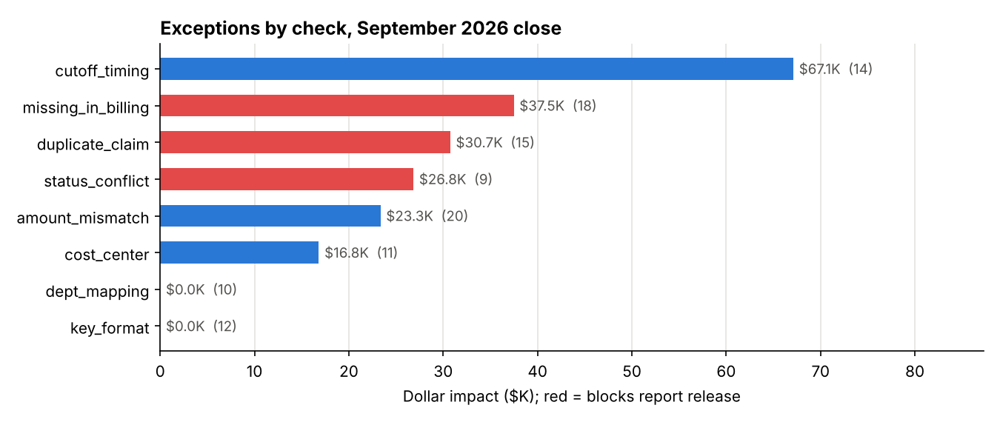

# Data Reconciliation Framework (SQL + Python)

Before month-end reports go to stakeholders, the numbers from different systems have to agree. This project is a **config-driven reconciliation framework** that checks a hospital's three revenue-cycle systems against each other, explains every discrepancy with a root cause, owner and fix, and runs a **release gate** that blocks reporting until critical issues are resolved.

```
EHR (encounters)  ──►  Billing (claims)  ──►  Finance (payments / GL)
     4,000                 3,997                   3,982
```

## What it catches



| Check | What it means | Owner | Blocks release |
|---|---|---|---|
| `missing_in_billing` | Care delivered, never billed (lost revenue) | Charge capture | ✅ |
| `duplicate_claim` | Claim resubmitted without voiding the original | Billing | ✅ |
| `status_conflict` | Cancelled encounter was billed | Billing | ✅ |
| `orphan_claim` | Claim points to an encounter that doesn't exist | Billing | ✅ |
| `amount_mismatch` | Charge changed after billing (beyond a $0.05 tolerance) | Charge capture | |
| `cutoff_timing` | Discharged in September, billed in October | Finance | |
| `dept_mapping` | New billing department code missing from the mapping table | Data engineering | |
| `cost_center` | Payment posted to the wrong cost center | Finance | |
| `key_format` | Billing system dropped leading zeros (`E123` vs `E000123`) | Data engineering | |
| *Department tie-out* | Department totals across all 3 systems within 0.5% | Finance | ✅ |

Every exception row carries its **root cause, owner team and recommended action**, so the report routes work rather than just listing problems.

## Results: September 2026 close

**Release gate: FAIL – hold reports.** There are 18 unbilled encounters, 15 duplicate claims and 9 billed cancellations, and the Neurology billing total is 1.65% off.

| Check | Exceptions | $ impact |
|---|---|---|
| cutoff_timing | 14 | $67,119 |
| missing_in_billing | 18 | $37,481 |
| duplicate_claim | 15 | $30,743 |
| status_conflict | 9 | $26,847 |
| amount_mismatch | 20 | $23,350 |
| cost_center | 11 | $16,818 |
| key_format · dept_mapping | 12 · 10 | (no $ impact) |

### Measured against a known answer key

The source data is generated with **109 deliberately injected discrepancies of 8 types**, the kinds that show up in real interfaces, recorded in `data/ground_truth.csv`. Every check caught **100% of its injected issues with 100% precision**, and a clean copy of the data **passes** the gate with zero exceptions.

These are designed issue types, so 100% shows the rules do what they claim. It doesn't predict performance on unknown real-world problems. The useful comparison is against a naive reconciliation that joins on exact keys and exact amounts:

| | Naive approach | This framework |
|---|---|---|
| "Missing" claims | 30 (12 are just key formatting) | **18** real + 12 explained as key drift |
| Orphan claims | 12 (all false) | **0** |
| Amount mismatches | 45 (25 are 1–2¢ rounding) | **20** real |
| **False alarms** | **49** | **0** |

Key normalisation and amount tolerances are what keep a reconciliation report trusted. Without them, analysts spend the release window chasing noise.

## How it works

1. **Config** ([`config/reconciliation.yml`](config/reconciliation.yml)): sources, key-normalisation rule, tolerances, release-gate rules, and for each check its SQL file, severity, owner, root cause and action. Adding a check means one SQL file plus five lines of YAML.
2. **SQL checks** ([`sql/`](sql/)): each returns `(encounter_id, detail, amount_impact)`, using anti-joins for completeness, `GROUP BY … HAVING` for duplicates, window functions to pick the first claim, and tolerance comparisons. They run in DuckDB and port to SQL Server or PostgreSQL with minor function changes.
3. **Engine** ([`recon/engine.py`](recon/engine.py)): loads sources, adds normalised keys, runs checks, runs the department tie-out and decides the gate.
4. **Report** ([`recon/report.py`](recon/report.py)): a formatted Excel workbook with four sheets (Release gate, Checks summary, Exceptions with owner and action, Dept tie-out with out-of-tolerance cells highlighted), plus a Markdown summary.
5. **Exit code:** `run_reconciliation.py` exits 1 when the gate fails, so a scheduler (cron, Airflow, Task Scheduler) can automatically stop downstream report refreshes.

## Run it

```bash
pip install -r requirements.txt
python data/generate.py          # create the three source extracts + answer key
python run_reconciliation.py     # → reports/reconciliation_2026-09.xlsx (+ .md), exit 1 if gate fails
pytest                           # 5 tests: clean data passes, every injected issue caught, no rounding false alarms
```

## Data

All data is **synthetic** (seeded, reproducible) and modelled on a hospital revenue cycle. No real patient information is used.

## Project structure

```
├── config/reconciliation.yml   checks, tolerances, gate rules, owners, actions
├── sql/                        one SQL file per check + department tie-out
├── recon/
│   ├── engine.py               load, normalise, run checks, gate
│   └── report.py               Excel + Markdown report, evaluation vs answer key
├── data/generate.py            three-system extract generator with injected issues
├── run_reconciliation.py
├── reports/                    generated workbook and summary
└── tests/
```

## Tools

SQL · DuckDB · Python · pandas · openpyxl (Excel) · YAML · pytest
